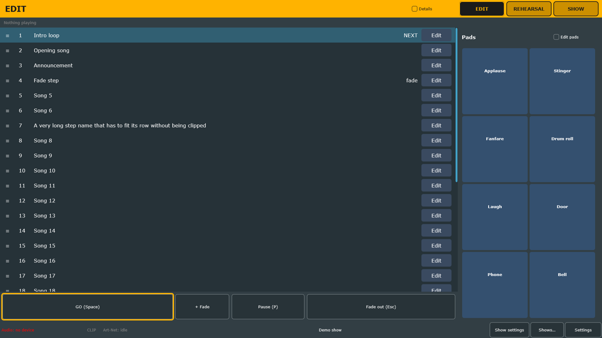
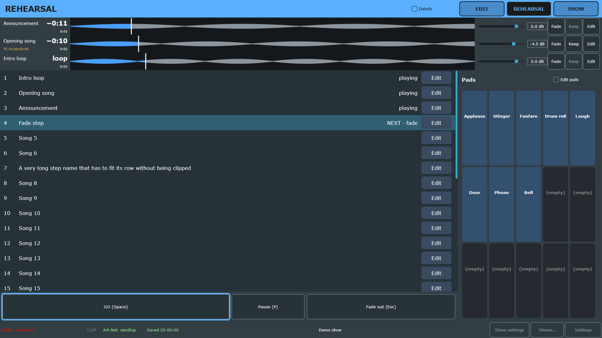
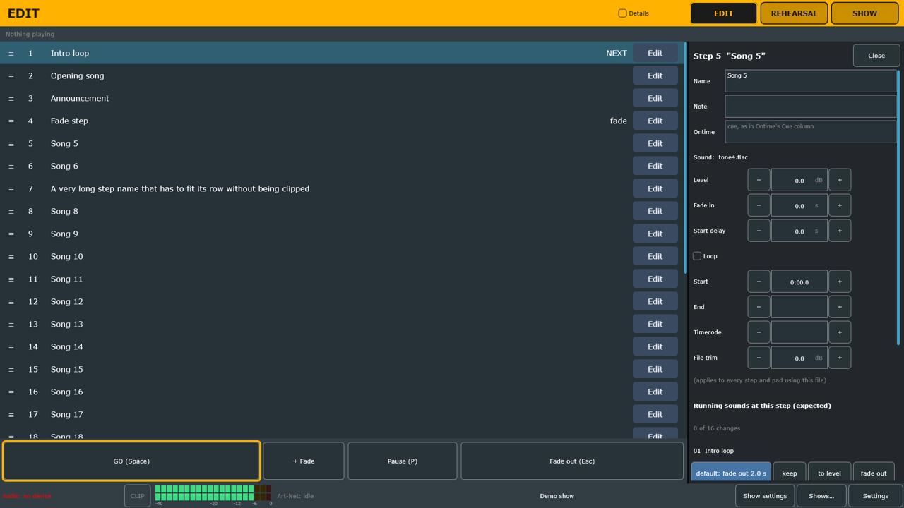
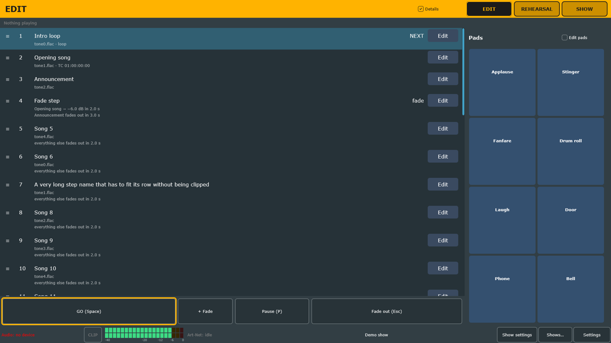

# Bigtop Player

Bigtop Player is a cue-based music player for live shows: a show is an ordered list of steps, and each GO runs the next one (starting a sound and/or changing the sounds already running), built in C++20 with a JUCE front end and a JUCE-free core engine.
Licensed under AGPLv3.

## Features

- Drop audio files (WAV, AIFF, FLAC, MP3, Ogg) on the list: each becomes a step, converted in the background with a progress bar on its row.
- New steps start at -6 dB (a show setting), so there is headroom to push them louder.
- A failed import has a Retry button on its row.
- Steps that are playing are tinted green in the list, so you see at a glance where the show is.
- One GO runs one step; the old sound fades out by itself, or keeps playing, as you choose.
- Fade steps and per-sound changes: keep, go to a level, fade out, each with its own time.
- A Details checkbox in the top bar shows under each step what it does: its file, level, fades, range, loop, timecode and the changes it makes. The NEXT row's "everything else" line tells what will really be faded: the sounds playing now, not a guess from the list. A step that fades everything else always keeps room for that line (blank when nothing is left to fade), so no row moves when it comes or goes.
- Screen readers (Windows Narrator) read the step list: number, name, NEXT, a missing file / import failed and the Details lines; activating a row makes it NEXT.
- Three modes (Edit, Rehearsal, Show) so nothing can be changed by accident during a show; what a mode does not allow is hidden, not just greyed out.
- Live faders, per-sound Fade, Keep, seeking, and Pause for everything at once (in Show mode too, if the show allows it).
- Each running sound shows its waveform behind the position bar (start to end, or the loop), played part in blue, so you see what is coming.
- A CLIP light that comes on only when the output limiter is heard (more than 1 dB), and stays lit until you tap it; a stereo level meter next to it.
- A pad grid for effects that play whatever the steps do, each with its own level and start and end points; drag a step onto a pad to reuse its sound.
- Art-Net timecode for the lighting desk, with a choice of network adapter.
- Export a show to one ZIP and import it on another system.
- Every 10 s the app checks the show's audio files: a missing or changed one turns its row red and shows a banner over the list.
- GO on a step whose file cannot play moves NEXT on to the next playable step and says why.
- Show check (in Show settings) lists every problem in one place, or says All clear.
- The system stays awake in Rehearsal and Show mode; closing the app in Show mode asks first.
- Ontime: GO can start an Ontime cue, and Pause, Resume and Esc can follow; a status light shows whether Ontime answers.
- Deleting a step that is playing asks first; its sound plays on.
- About (in Settings) names the version, the licence and the project page.









More, in plain words: see the [wiki pages](docs/wiki/Home.md).

## Download

Get the Windows ZIP from the [Releases page](https://github.com/bigtop-player/bigtop-player/releases), unzip it into any folder and start `Bigtop Player.exe`. There is nothing to install: the exe is a single file. Your shows and settings are not in the ZIP; they stay where you choose them during project setup.

## Build from source

Minimal build including tests:
```
cmake -B build
cmake --build build --config Debug
ctest --test-dir build -C Debug --output-on-failure
```

Also build the JUCE-based io library and its tests:
```
cmake -B build -DBIGTOP_BUILD_IO=ON
[...]
```

Build the JUCE-based app including io:
```
cmake -B build -DBIGTOP_BUILD_APP=ON
[...]
```

Built the core and its tests with ThreadSanitizer (GCC/Clang only; ignored on MSVC):
```
cmake -B -DBIGTOP_TSAN=ON
[...]
```

## Running the app

- Build the complete app:
```
cmake -B build -DBIGTOP_BUILD_APP=ON
cmake --build build --config Release
```
- Start `build\app\bigtop_app_artefacts\Release\Bigtop Player.exe`

### Configuration and options

- Settings (last show, audio device) are in `%APPDATA%\Bigtop Player\settings.xml`; `--settings <file>` uses another file.
- `--screenshots <folder>` renders the main screens (start panel, modes, editors, running sounds, pads; at 1024, 1366 and 1920 px wide) of a generated demo show to PNG files and quits, without opening a window or touching your settings; the exit code is 0 when all files were written.
- `--docs-screenshots <folder>` renders the curated set used by this README and the wiki (laid out at 1920x1080, written at 1280x720) into `docs/images/` the same way.
- A show is a plain folder you choose: `show.json`, `state.json`, `audio/` (imported FLAC files) and `backups/`.

## Moving a show to another system (export and import)

A show folder keeps every dropped file unchanged in `sources/` (named by its SHA-256), next to the converted FLAC in `audio/`.
Shows made before this feature have no originals; they export their FLACs instead.

- **Export:** in Edit mode press "Shows..." to reach the start panel, then "Export show...". Pick a folder; the app writes `<ShowName>-YYYYMMDD-HHMM.bigtop.zip` there. It holds `show.json`, `state.json` and, for each audio file a step or pad uses, the original (the FLAC when there is no original). No backups, no unused files. Entries are stored uncompressed, so the ZIP is as big as the originals: smaller than the 48 kHz 24-bit FLACs for MP3s, about the same for WAVs. A ZIP holds at most 4 GB: a show whose audio adds up to more is refused before anything is written.
- **Import:** on the start panel (also at launch) press "Import show...", pick the ZIP, then an empty folder. The ZIP is unpacked and checked (a damaged ZIP, a missing `show.json`, a `show.json` the app cannot read, any path leaving the folder, or two entries with the same name is refused and the folder is left empty), then the show opens in Edit mode. The FLACs the ZIP left out are converted again: their rows say "importing..." and GO is refused until they are done. The same happens when you open any show whose FLAC is gone but whose original is still in `sources/`.

## How the step model works

A show is an ordered list of **steps**.
One press of GO runs one step, then the highlight moves to the next one.

A step can do either or both of two things:

- **Start a sound**: a file with a level, a fade-in time, optional start/end points (with a 10 ms declick when they fall inside the music), loop and start delay.
- **GO on a step that is still playing** starts it again from its start point, and the copy that was playing fades out like any sound a GO ends: by the step's "everything else" fade time, or the show's default fade when the step keeps everything else or has its own change for that sound (its own fade-out change is used as it is). For a few seconds you hear both copies; shorten that step's fade time for a quicker change.
- **Change sounds that are already running**: for each one, *keep*, *go to level X dB*, or *fade out*, each with its own time. A time of 0 is immediate, with a 10 ms declick (so a level change or fade out never clicks).

A **fade step** is a step that starts no sound and only changes the running ones.
Add one with "Add fade step"; it goes in after NEXT.

Every step also has an **everything else** rule for running sounds it does not mention: fade out over a time, or keep.
A step that starts a sound fades the rest out over 2 s by default; a step that starts nothing keeps them.
A plain playlist therefore needs no configuration.

Three **modes**, switched in the strip at the top: **Edit** (everything), **Rehearsal** (play and tune levels and times, no structural edits) and **Show** (only GO, fade out, faders and pads).
Leaving Show takes a 2 s hold, so a stray touch cannot change the mode.

**Pause** (button or P) freezes all step sounds, including waiting start delays, and Resume carries on; pads keep playing, and GO is refused while paused.
Each running sound has its own position bar (drag to seek), Fade, and Keep, which makes the current fader position the step's new level.

The side area is a **pad grid** (rows x columns in Show settings, up to 24): a tap plays a pad or fades it out, whatever the steps do.
"Edit pads" opens a pad's editor instead; it also works while the pad plays: a new level or trim is heard at once with a short ramp (no click), Clear pad fades the sound out like a second tap.

There are no control cues and no cue numbers to type.
A running sound is identified by the step that started it, and jumping around the list never starts or stops anything by itself.

The design's own example, four steps in a row:

```
 #  GO does                        Running sounds after GO
 4  Start ATMO (loop), fade in 3s  Music A: fade out 5s   | Atmo: 0 dB
 5  (no new sound)                 Atmo: to -12 dB in 2s
 6  Start MUSIC B, fade in 5s      Atmo: to -15 dB in 3s  | Music B: 0 dB
 7  (no new sound)                 Atmo: fade out 8s      | Music B: keep
```

`core/tests/SpecExampleTests.cpp` is the runnable version: it plays these steps through the engine and checks the mix at fixed times.

## How this is built

Bigtop Player is written mostly by Claude, Anthropic's coding agent, under the direction of its maintainer, who decides what gets built and how it should behave.
Every change is reviewed and must pass the full test suite (core engine, audio io and windowless GUI tests) with warnings treated as errors before it is merged, and releases are tried on real show hardware.
Commits written with Claude carry a `Co-Authored-By: Claude` line.
The rules the agent works by are in [AGENTS.md](AGENTS.md); they are the same rules human contributors follow.

## Contributing

Bug reports, ideas and pull requests are welcome.
[CONTRIBUTING.md](CONTRIBUTING.md) explains how to build, test and send a change.

## License

AGPLv3, see [LICENSE](LICENSE).
