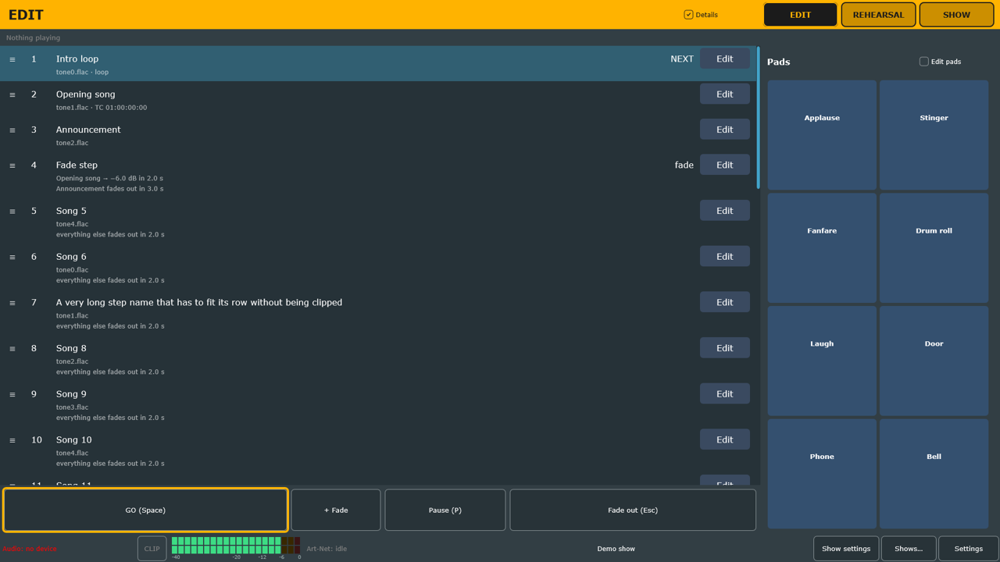
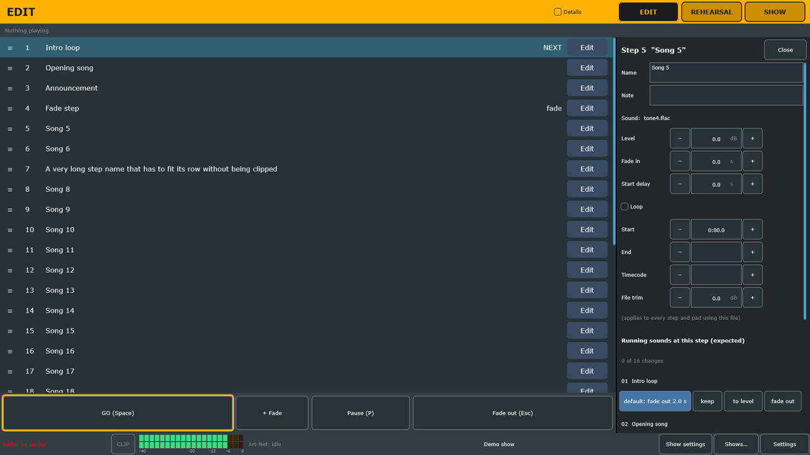
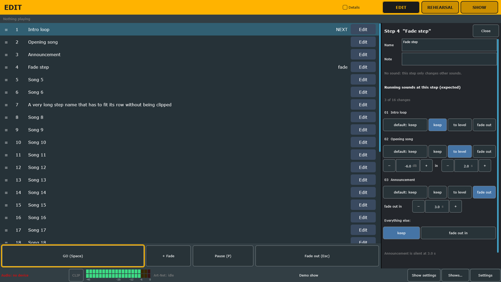
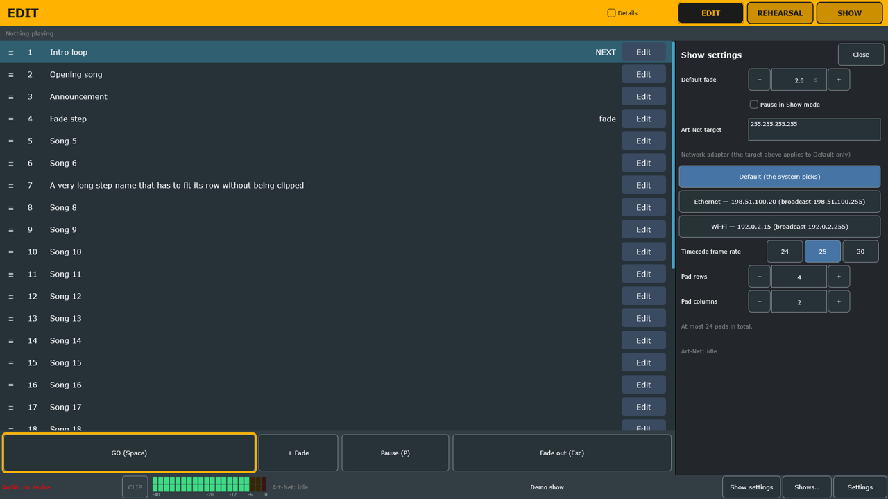

# Building a show

Work in **Edit** mode. A show is a list of **steps**; one GO runs one step.

## Add, reorder, delete

- Drop files on the list: they land where the insertion line is.
- Drag a row by the grab handle at its left edge (three bars, 48 px wide) to move it. The line shows where it will land; the list scrolls near its edges. Moving rows never changes which step is NEXT.
- Press Delete on the selected row, or "Delete step" in the editor. The audio file stays in the show folder.
- **+ Fade** inserts a step with no sound after NEXT.

## Details

Tick **Details** in the coloured mode bar at the top (any mode) to see under each step's name what it does, in smaller grey lines:

- a sound step's first line: the file name, then only what differs from the default: level, fade in, wait (start delay), start–end range, loop, timecode start, OnTime cue. A file that cannot play is shown in red;
- one line per sound the step changes, named by the step that started it ("Opening song → −6.0 dB in 2.0 s", "Announcement fades out in 3.0 s"); kept sounds get no line;
- "everything else fades out in 2.0 s" when the step fades the rest and something would really be left to fade: a sound started earlier in the list, still running (not faded out by an earlier step), and not named by this step. Keeping them gets no line. On the other rows this is worked out from the list, so sounds that end by themselves and GOs out of list order are not taken into account. The NEXT row looks at what really plays now instead: a sound that ended by itself or is already fading out does not count, a sound started out of order does, and with nothing left to fade the line goes away. A step that fades everything else always keeps the room for this line, blank when there is nothing to fade, so a row never changes height and no row moves under your finger while songs end.

A 0 s time reads "immediately". The laptop remembers the choice; it is not saved in the show. With Details off the list looks as it always did.

## The step editor

Press **Edit** on a row. The panel on the right has the step's name and note, level, fade-in, start delay, loop, start and end points (m:ss.d), the timecode start and the file trim. A start or end point inside the music gets a 10 ms declick, so it never clicks.

## Changes to running sounds, and fade steps

A step can also change sounds that are already playing: for each, **keep**, **go to level X dB** or **fade out**, each with its own time (0 = immediate, with a 10 ms declick). A **fade step** has no sound of its own and only does this. A change for a sound that is not running is greyed out; Remove deletes it. A step holds up to 16 changes.

## Everything else

Sounds the step does not mention follow the step's **everything else** rule: fade out over a time, or keep. A step that starts a sound fades the rest out over 2 s by default; a step with no sound keeps them. A plain playlist therefore needs no setup.

## Show settings and pads

**Show settings** (Edit mode) holds the default fade time, "Pause in Show mode" (off by default: Show mode then has no Pause), the Art-Net target and adapter, the timecode frame rate and the pad grid size (rows by columns, up to 24 pads). In Edit mode, drop a file on a pad to assign it, or drag a step by its grab handle onto a pad: the pad takes the step's sound, name, start and end (its own level stays), with no new import; turn on "Edit pads" to open a pad's editor (name, level, trim, and start and end points) instead of firing it. Start and end work like a step's: the pad plays only that part of the file (an empty End plays to the file's end); they are set in Edit mode and apply from the next tap. Dropping a new file on a pad clears them: a new sound plays whole. The editor also works while the pad plays: a new name changes only the label, a new level or trim moves the running sound there over 10 ms (no click), and Clear pad fades the sound out exactly as a second tap would, then the pad is empty.

