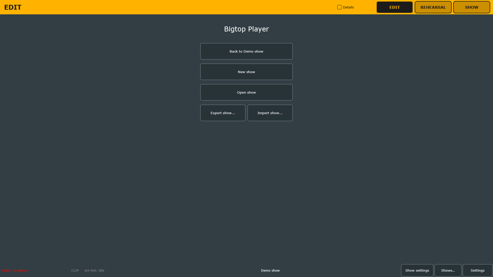

# Export and import

To move a show to another laptop, or keep a copy.

## Export

In Edit mode press **Shows...** in the status bar to reach the start panel, then **Export show...** and pick a folder. The app writes `<ShowName>-YYYYMMDD-HHMM.bigtop.zip` there. It holds the show and the original audio files it uses (shows made by older versions have no originals and export their FLACs instead), not backups or unused files. It is about as big as your original files. A zip holds at most 4 GB; a bigger show is refused with a message before anything is written.

## Import

On the start panel press **Import show...**, pick the zip, then an empty folder. The zip is checked and unpacked, and the show opens in Edit mode. Files that were left out are converted again: their rows say "importing..." and GO is refused until they are done. A damaged zip is refused and the folder stays empty.

