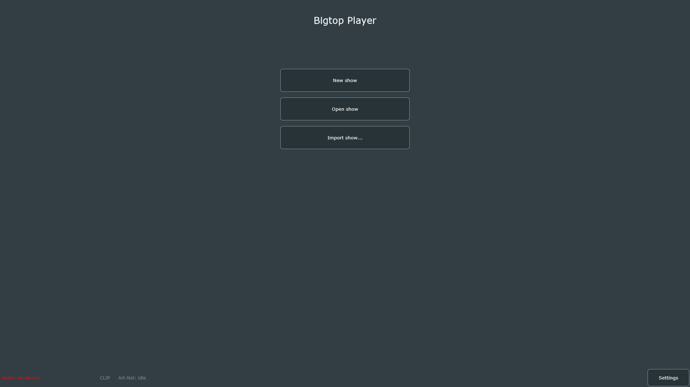

# Getting started

## Install

Nothing is installed. Download the Windows ZIP from the [Releases page](https://github.com/bigtop-player/bigtop-player/releases), unzip it anywhere and start `Bigtop Player.exe`. Your shows and settings are not in the ZIP; they stay where they are.

## Make a show

1. On the start panel press **New show** and pick an empty folder. That folder is your show: keep it on the system's own disk.
2. Drag audio files (WAV, MP3 or FLAC) from Windows Explorer onto the step list. Each file becomes a step, named after the file. The app converts it in the background; the row says "importing..." until it is ready.
3. Press **GO** (or Space) to run the highlighted step. The highlight moves to the next one.

A plain list of songs needs nothing else: every GO starts the next song and fades the old one out over 2 seconds.

Next: [Modes](Modes.md) and [Building a show](Building-a-show.md).
