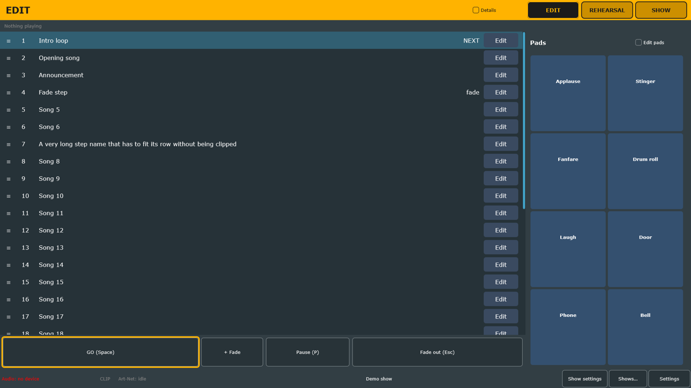

# Bigtop Player wiki

Short pages for the person running the show. The screenshots show an invented "Demo show"; the app renders them itself (see the README, "Before you push"), so they match the current screens.

1. [Getting started](Getting-started.md): get the app, make a show, drop files, press GO.
2. [Modes](Modes.md): Edit, Rehearsal and Show.
3. [Building a show](Building-a-show.md): the step editor, fade steps, changes, "everything else", reordering.
4. [Running a show](Running-a-show.md): GO, fade out, pause, faders, Keep, pads.
5. [Timecode and Art-Net](Timecode-and-Art-Net.md): sending timecode to the lighting desk.
6. [Export and import](Export-and-import.md): moving a show to another system.
7. [Troubleshooting](Troubleshooting.md): known limits and what to do.

Before a show, run it once on the show system with the real audio interface and lighting network: every button, GO through the whole list, unplug and replug the interface, and Show check.

