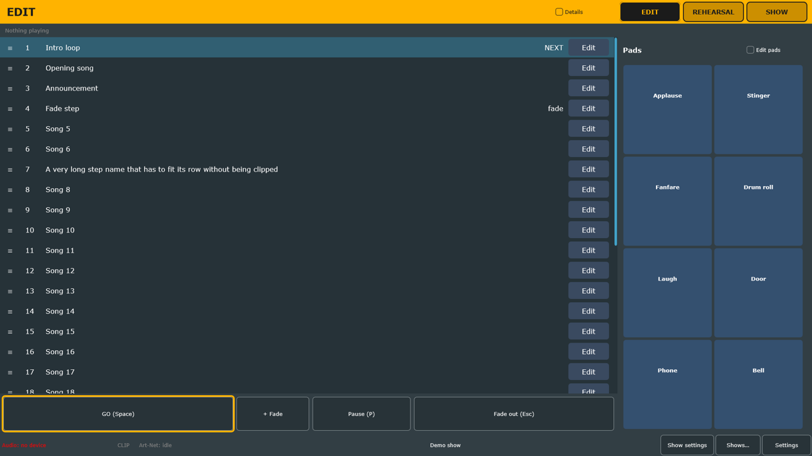
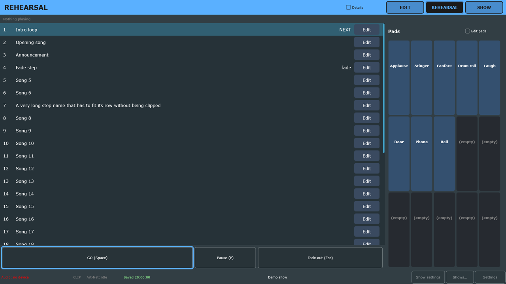
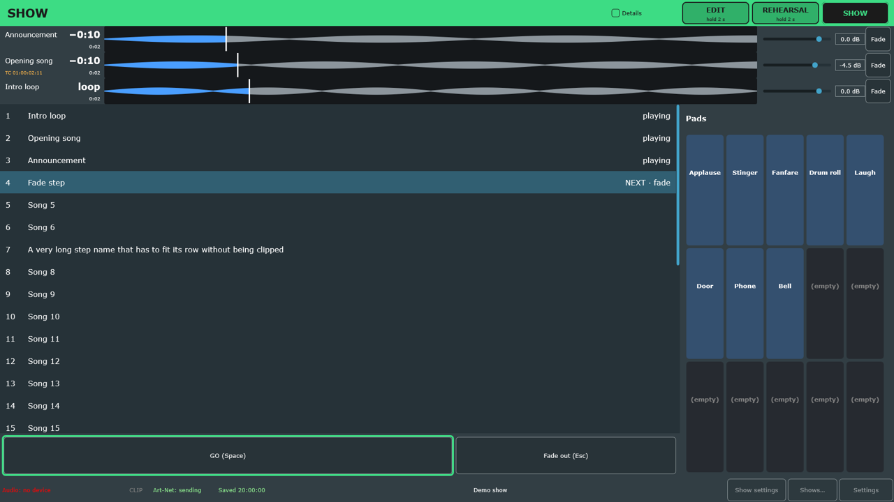

# Modes

The strip at the top switches between three modes. The colour of the strip and of the GO button's border tells you which one you are in.

| Mode | For | What you can do |
|---|---|---|
| **Edit** | building the show | everything: drop files, reorder, delete, edit every field, Show settings |
| **Rehearsal** | tuning | play, and change levels and times only; names, notes, loop, start/end, timecode and the kind or target of a change are Edit-only, as are adding, deleting and reordering |
| **Show** | the performance | GO, Fade out, faders, per-sound Fade, seeking, choosing NEXT and the pads; Pause is hidden |

Leaving Show mode takes a **2 second hold** on the Edit or Rehearsal button (a bar fills); let go early and nothing changes. So a stray touch cannot change the mode during a show.

