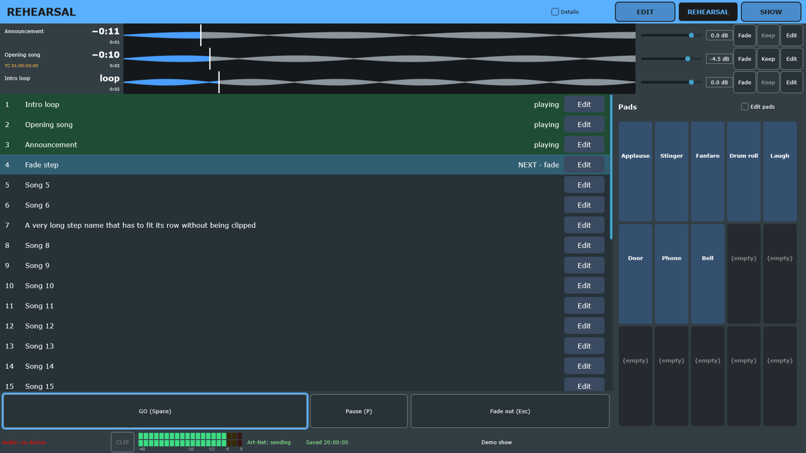

# Running a show

- **GO** (button or Space) runs the highlighted step. Rows whose sound is playing are tinted green; when the NEXT row is also playing, it keeps the NEXT colour with a green bar at its left edge. Two GOs within a fraction of a second count as one.
- **Details** in the top bar shows what each step will do (fades, level changes, everything else) before you press GO; see [Building a show](Building-a-show.md#details). The NEXT row's "everything else" line tells what will really be faded: the sounds playing now (waiting start delays included, pads never), so a song that ended by itself drops out of it (the line goes blank; the rows do not move).
- **GO on the step that is playing** starts it again from the top; the copy that was playing fades out over the step's "everything else" time (2 s by default), as any sound a GO ends. Fade out (Esc) stops that fading copy at once.
- **Fade out** (button or Esc) fades everything; a second press stops it at once.
- Each **running sound** shows its step's name; a long name wraps to a second line and ends in "..." when even that is too short (the step list shows it in full).
- **Faders** on each running sound change its level live. Double-click returns to 0 dB.
- **Keep** (Edit and Rehearsal) is greyed out while the fader is at 0 dB and lights up when you move it. It stores what you hear where that sound's level was last set: in the step that last changed its level, or else in the step that started it.
- **Fade** on a running sound fades just that sound; a second tap while it fades stops it.
- The **position bar** shows the sound's progress; drag it to seek. Behind it you see the sound's waveform from its start to its end point (the loop range for a loop): the played part in blue, what is coming in grey, so drops and endings show before you hear them. The waveform appears a moment after a show opens or a file finishes importing (it is read in the background); until then the plain bar is shown.
- **CLIP** in the status bar lights when the output limiter turns the level down by more than 1 dB, where you start to hear it working. A loud master peaking at 0 dBFS stays dark; two loud songs overlapping in a crossfade, or a fader pushed up, light it. It stays lit until you tap it (in any mode), so an over is never missed; if the limiter is still working, it lights again at once. Next to it a **level meter** shows the output (left above, right below) in 2 dB segments from -40 to 0 dBFS, with a scale under it: green, amber from -6 dB, red in the top 2 dB, and the highest segment of the last second stays lit.
- **Screen readers** (Windows Narrator) read the step list as a list: each row's number, name, "next", a missing file / import failed and, with Details on, its Details lines. Activating a row makes it NEXT, as a tap does.
- **Pause** (button or P; hidden in Show mode unless Show settings has "Pause in Show mode" ticked) fades over 0.1 s and freezes all step sounds, including waiting start delays. Resume carries on from the same place. GO is refused while paused; pads keep playing. Esc while paused stops everything at once and ends the pause. Show mode cannot be entered while paused, unless the show allows Pause in Show mode.

## Pads

The pad grid on the right plays a sound with one tap, whatever the steps do. A pad fires when your finger lifts, not when it touches. Tap again to fade it out. A playing pad is green with its remaining time.

