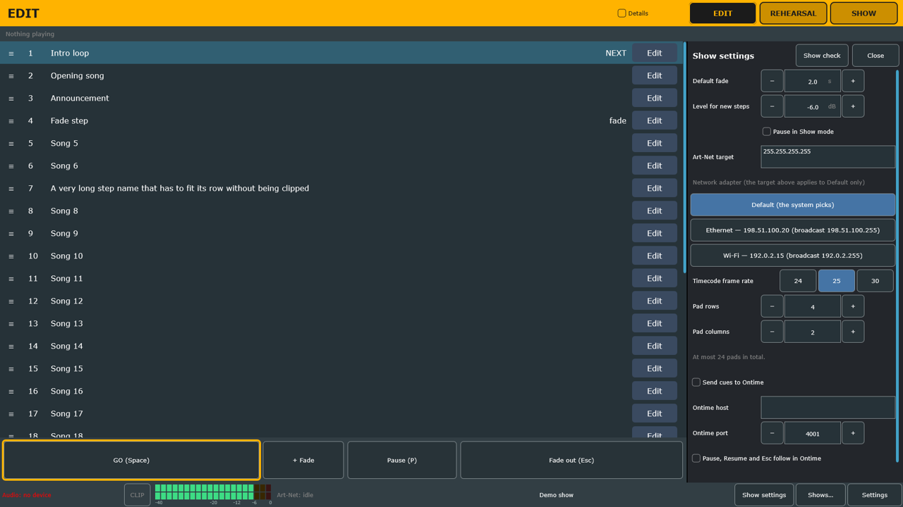

# Timecode and Art-Net

A step can set a **timecode start** (hh:mm:ss:ff). While that step's sound plays, the app sends the timecode over the network as Art-Net, so a lighting desk can follow it. Pausing holds the last frame; when nothing drives timecode, nothing is sent.

## Setup

1. Open **Show settings** (Edit mode).
2. Set the **frame rate** (24, 25 or 30) to what the desk expects.
3. Choose the **network adapter**. "Default" lets Windows pick, which may be the wrong one when Wi-Fi and Ethernet are both active. Pick the adapter the desk is connected to and the app sends to that network's broadcast address. This choice belongs to the system, not to the show.
4. The status bar shows "Art-Net: sending", "idle" or an error. A network problem never affects the audio.

If the chosen adapter is missing (for example the desk's cable is not plugged in yet), the app uses Default and says so in the status bar. It keeps looking about once a second and switches to the chosen adapter as soon as it appears. If sending fails (a pulled cable), the app retries every frame and picks up again once the network is back.

## Ontime

Bigtop can start cues in [Ontime](https://www.getontime.no/).
It works in one direction: Bigtop tells Ontime.

- In **Show settings** tick "Send cues to Ontime" and enter Ontime's host (an IPv4 address or a host name) and port (4001 by default).
- In a step's editor, enter the **Ontime cue**: the text in that event's Cue column in Ontime. GO on that step sends `/api/start/cue/<cue>` to Ontime. A repeat GO on a playing step sends it again; a refused GO sends nothing.
- "Pause, Resume and Esc follow in Ontime" (off by default) also sends pause, start and stop.
- The status bar's **Ontime** light is grey while it waits for the first answer, green when Ontime answers (the app asks for its version every 5 s), red when it does not (the reason is the tooltip). A show without Ontime shows no light.
- Requests go out one after another in the background with a 1 s timeout, so GO never waits for Ontime. A failed start is not sent again (a late start would be worse) and raises the banner once.
